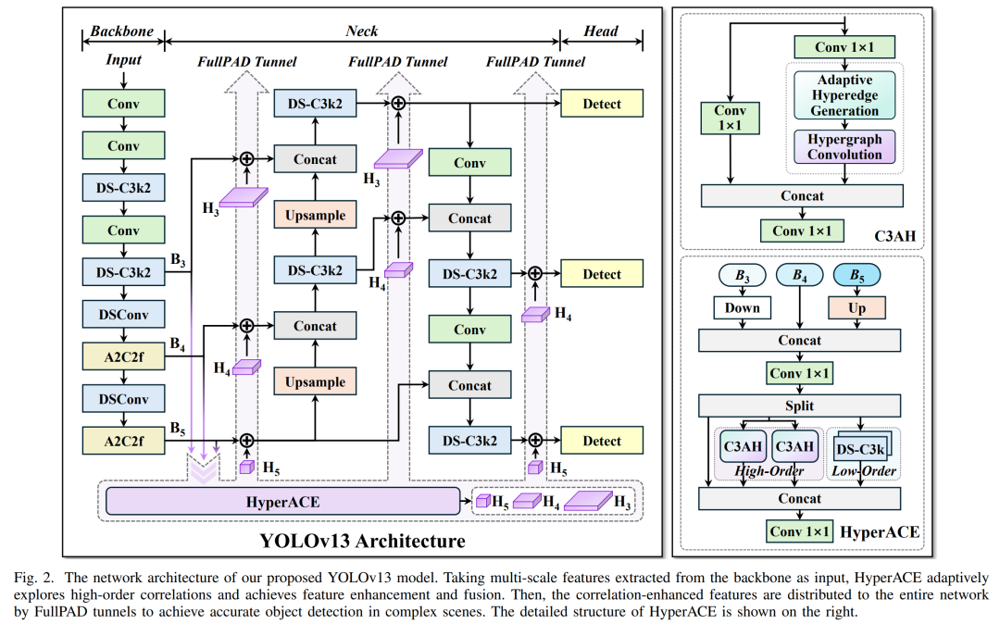
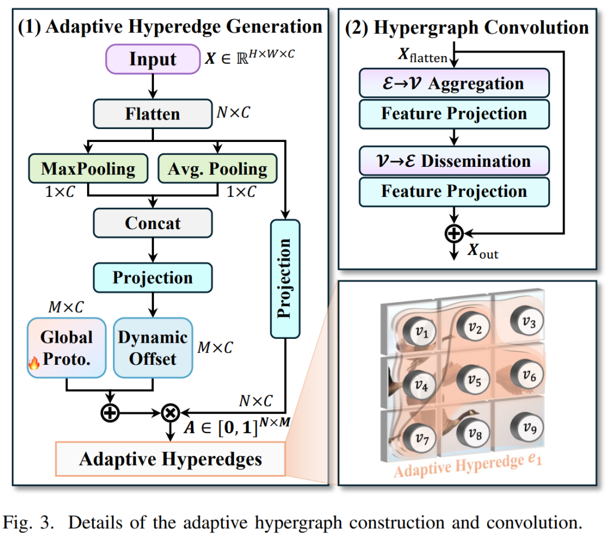
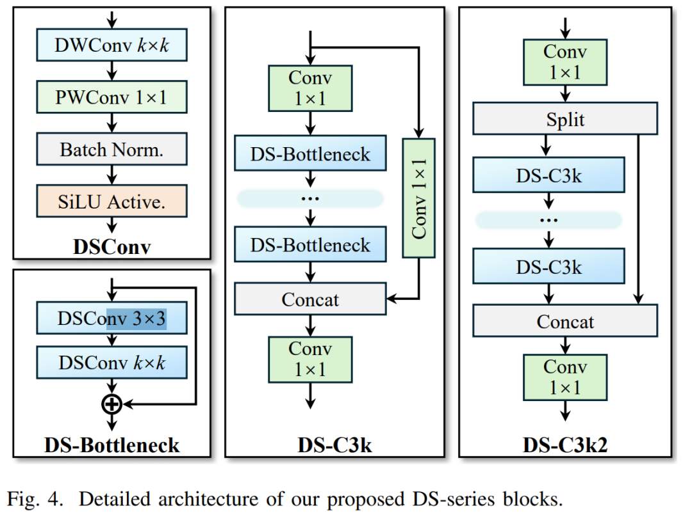
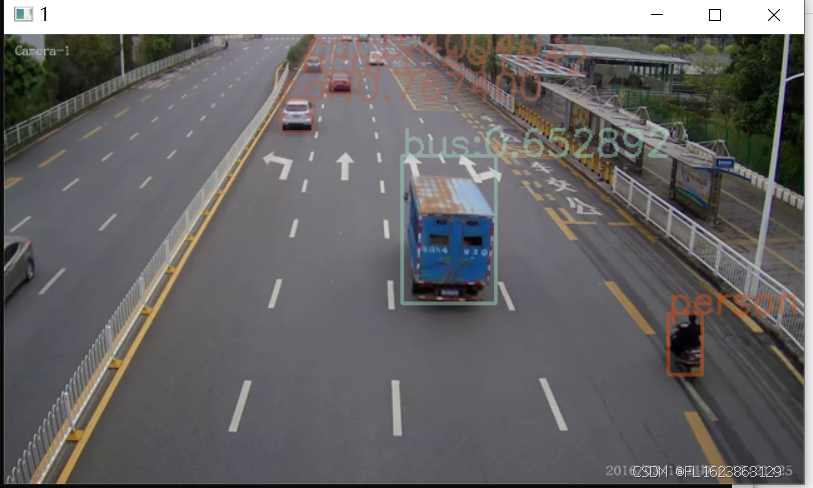

# [C++] deploying the Yolov13 target detection ONNX model using pure OpenCV

[Algorithm Introduction] The paper introduces the YOLOv13 model, which contains three main innovations: a. Based on hypergraphs, an adaptive relevance enhancement mechanism.

[Algorithm Introduction]

The paper proposes the YOLOv13 model, which contains three core innovations:

 Edit

#### a. HyperACE based on hypergraphs for adaptive relevance enhancement

The most core innovation of YOLOv13 is aimed at effectively capturing the potential high-order correlations between features.

 Edit

-

-

**Basic Principle**: This mechanism draws on the theory of **Hypergraphs**. Unlike in ordinary graphs where each edge can only connect two vertices, a "hyperedge" (a hyperedge) in a hypergraph can connect multiple vertices simultaneously, making it naturally suited for modeling "many-to-many" relationships.

-

-

**Adaptive Super-edge Generation**: To overcome the shortcomings of traditional hypergraph methods that rely on manual parameter settings, HyperACE has designed an adaptive super-edge generation module. This module can learn and construct super-edges dynamically based on input visual features, exploring potential associations between different feature vertices.

-

-

SuperMap Convolution: After generating the adaptive hyperedges, feature aggregation and enhancement are performed through SuperMap convolution operations. Each super-edge first aggregates information from all the vertices it connects, forming higher-order features; Subsequently, these high-level features are propagated back to each vertex, thereby completing the update and enhancement of vertex features.

#### b. Fully Integrated Process Aggregation and Dissemination Paradigm (FullPAD)

To maximize the utility of enhanced features after HyperACE, the author designs a new network information flow paradigm called FullPAD.

-

-

**Workflow**: FullPAD first gathers multi-scale features from the backbone network and feeds them into the HyperACE module for processing. Subsequently, through a dedicated "FullPAD channel," these high-order correlated enhanced features are re-distributed to multiple critical locations within the network, including the connection between the backbone network and the neck, within the neck network itself, and at the connection between the neck and the detection head.

-

-

**Design Objective**: This design aims to break the unidirectional information flow in traditional YOLO architectures, achieve information collaboration and fine-grained flow across the entire network, thereby improving gradient propagation and enhancing detection performance.

#### c. Deep Separable Convolutional Lightweight Design

To ensure high efficiency, YOLOv13 employs **Depthwise Separable Convolution (DSConv)** as the foundational unit. A series of lightweight modules, such as DSConv, DS-Bottleneck, DS-C3k, and DS-C3k2, are designed to replace standard large kernel convolutions. These modules are widely used in the backbone and neck networks of the model, significantly reducing both parameter count and computational complexity (FLOPs) without sacrificing model performance.

 Edit

[Effect Display]

 Edit

[Test Environment]

vs2019
cmake==3.30.1
opencv==4.8.0

[Code Invocation]

-

```

```

-
-
-
-
-
-
-
-
-
-
-
-
-
-
-
-
-
-
-
-
-
-
-
-
-
-
-
-
-
-
-
-
-
-
-
-
-
-
-
-
-
-
-
-
-
-
-
-
-
-
-
-
-
-
-
-
-
-
-
-
-
-
-
-
-
-
-
-
-
-
-
-
-
-
-
-
-
-
-
-
-
-
-
-
-
-
-
-
-
-
-
-
-
-
-
-
-
-
-
-
-
-
-
-
-
-
-

```
#include <iostream>#include<opencv2/opencv.hpp>#include<math.h>#include "yolov13.h"#include<time.h>#define  VIDEO_OPENCV //if define, use opencv for video.using namespace std; using namespace cv; using namespace dnn; template<typename _Tp>int yolov13(_Tp& cls,Mat& img,string& model_path){	Net net; if (cls.ReadModel(net, model_path, false)) {		cout << "read net ok! " << endl; }	else {		return -1; } // Generate random color srand(time(0)); for (int i = 0; i < 80; i++) {		int b = rand() % 256; int g = rand() % 256; int r = rand() % 256; color.push_back(Scalar(b, g, r)); }	vector<OutputSeg> result; if (cls.Detect(img, net, result)) {		DrawPred(img, result, cls._className, color); }	else {		cout << "Detect Failed! " << endl; }	system("pause"); return 0; }template<typename _Tp>int video_demo(_Tp& cls, string& model_path){	vector<Scalar> color; srand(time(0)); for (int i = 0; i < 80; i++) {		int b = rand() % 256; int g = rand() % 256; int r = rand() % 256; color.push_back(Scalar(b, g, r)); }	vector<DetecionResult> result; cv::VideoCapture cap("car.mp4"); if (! cap.isOpened())	{		std::cout << "open capture failured! " << std::endl; return -1; }	Mat frame; #ifdef VIDEO_OPENCV	Net net; if (cls.ReadModel(net, model_path, true)) {		cout << "read net ok! " << endl; }	else {		cout << "read net failured! " << endl; return -1; }#else	if (cls.ReadModel(model_path, true)) {		cout << "read net ok! " << endl; }	else {		cout << "read net failured! " << endl; return -1; }#endif	while (true)	{		cap.read(frame); if (frame.empty())		{			std::cout << "read to end" << std::endl; break; }		result.clear(); #ifdef VIDEO_OPENCV		if (cls.Detect(frame, net, result)) {			DrawPred(frame, result, cls._className, color, true); }#else		if (cls.OnnxDetect(frame, result)) {			DrawPred(frame, result, cls._className, color, true); }#endif		int k = waitKey(10); if (k == 27) { //esc 			break; }	}	cap.release(); system("pause"); return 0; }int main() {	string detect_model_path = "./yolov13n.onnx"; Yolov13 detector; video_demo(detector, detect_model_path); }
```

-

```

```

```

```


## Payment

Here is a pay link on Stripe ( https://buy.stripe.com/3cs8yP7sY87d0vu9AB ). Please contact me lonlonago@foxmail.com after funding $89, and I will send you a complete data files , thank you!


